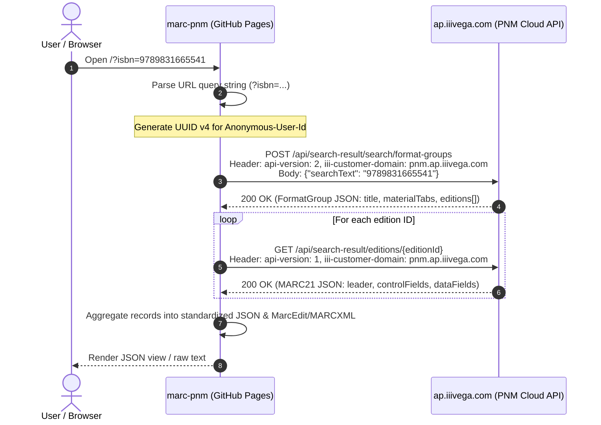

# AGENTS.md — marc-pnm Developer & Agent Guide

Welcome to **marc-pnm** (`pustaka-terbuka/marc-pnm`). This document provides autonomous AI agents, coding assistants, and human contributors with the architectural guidelines, API contracts, domain context, and testing workflows required to maintain, enhance, and debug this repository.

---

## 1. Project Overview & Mission

* **Name**: `marc-pnm`
* **Organization**: [Pustaka Terbuka](https://github.com/pustaka-terbuka)
* **Live Deployment**: [https://pustaka-terbuka.github.io/marc-pnm/](https://pustaka-terbuka.github.io/marc-pnm/)
* **Repository**: [https://github.com/pustaka-terbuka/marc-pnm](https://github.com/pustaka-terbuka/marc-pnm)
* **Core Function**: Client-side web application and programmatic URL resolver that searches books by ISBN in the **Perpustakaan Negara Malaysia (PNM) OPAC** and extracts complete **MARC21 bibliographic records** in structured JSON format.
* **Target Audience**: Librarians, cataloguers, school library coordinators (Guru Perpustakaan dan Media / GPM), ILS developers (Koha, ErrinILS, SPeP), and book metadata researchers in Malaysia.

---

## 2. Core Architectural Principles

AI agents working in this repository must strictly adhere to the following principles:

### 2.1 Zero External Dependencies (No Build Steps)
* **Pure Vanilla Web Standards**: The entire application consists of static HTML5, CSS3, and ES6+ JavaScript.
* **No Build Tools**: Do NOT introduce Node.js build tools (Vite, Webpack, Babel), package managers (`package.json`, `npm`, `yarn`), or runtime frameworks (React, Vue, Angular).
* **No External CDNs**: Avoid pulling external CSS or JS libraries from unpinned CDNs (e.g. Bootstrap, Tailwind CDN, jQuery). The application must remain self-contained, high-performance, and resilient to third-party CDN downtime.

### 2.2 Direct Client-Side Browser CORS
* PNM's cloud OPAC API (`https://ap.iiivega.com`) natively reflects and permits CORS (`Access-Control-Allow-Origin: *`) and allows custom headers (`Access-Control-Allow-Headers`).
* **Never add an intermediate server, serverless proxy (Cloudflare Workers / Vercel), or scraping backend** unless PNM explicitly blocks direct cross-origin browser requests in the future.

### 2.3 Query String First-Class Contract
The application functions as a web-based API endpoint through URL query parameters:
* `?isbn=<ISBN>` or `?q=<ISBN>`: Automatically triggers the search and displays the structured MARC JSON.
* `?raw=true` or `?raw=1`: Bypasses the graphical UI and outputs raw unstyled JSON text, designed for headless browser fetchers and curl/script consumers.

---

## 3. Repository Structure

```text
D:/GitHub/pustaka-terbuka/marc-pnm/
├── .git/                      # Git version control metadata
├── .nojekyll                  # Bypasses Jekyll processing on GitHub Pages
├── AGENTS.md                  # This agent & developer guide
├── LICENSE                    # MIT License
├── README.md                  # Public documentation & API reference
└── index.html                 # Self-contained web app (UI, state, API client, MARC formatters)
```

---

## 4. PNM OPAC Architecture & API Specification

PNM's OPAC ([opac.pnm.gov.my](https://opac.pnm.gov.my/)) runs on **Innovative Interfaces Vega Discover** (Clarivate). The underlying REST API gateway resides at `https://ap.iiivega.com`.

### 4.1 Sequence Diagram



### 4.2 Required HTTP Headers

All requests dispatched to `https://ap.iiivega.com` must include:

| Header Name | Value | Purpose |
| :--- | :--- | :--- |
| `iii-customer-domain` | `pnm.ap.iiivega.com` | Identifies Perpustakaan Negara Malaysia tenant in Vega |
| `iii-host-domain` | `opac.pnm.gov.my` | Validates host domain mapping |
| `Anonymous-User-Id` | Generated UUID v4 | Required for anonymous session state in Vega gateway |
| `Accept` | `application/json, text/plain, */*` | Standard response format negotiation |

---

### 4.3 Endpoint Reference

#### Step 1: Search Editions by ISBN
* **Method**: `POST`
* **URL**: `https://ap.iiivega.com/api/search-result/search/format-groups`
* **Specific Header**: `api-version: 2`, `Content-Type: application/json`
* **Body**:
  ```json
  {
    "searchText": "9789831665541"
  }
  ```
* **Response Traversal**:
  * Traverse `data[]` $\rightarrow$ `materialTabs[]` $\rightarrow$ `editions[]`.
  * Collect unique `edition.id` (UUID), `edition.recordId` (PNM catalog ID), and `edition.callNumber`.

#### Step 2: Retrieve Full MARC Record
* **Method**: `GET`
* **URL**: `https://ap.iiivega.com/api/search-result/editions/{editionId}`
* **Specific Header**: `api-version: 1`
* **Response Structure**:
  ```json
  {
    "source": "MARC",
    "marcRecord": {
      "leader": "00000aam a2200000 i 4500",
      "controlFields": {
        "001": ["1356755"],
        "005": ["20260611152116.0"],
        "008": ["220719s2022    my a   b      000 0 may  "]
      },
      "dataFields": {
        "020": [{ "ind1": " ", "ind2": " ", "subfields": [{ "code": "a", "value": "9789831665541" }] }],
        "100": [{ "ind1": "0", "ind2": " ", "subfields": [{ "code": "a", "value": "Author Name" }] }],
        "245": [{ "ind1": "1", "ind2": "0", "subfields": [{ "code": "a", "value": "Main Title :" }, { "code": "b", "value": "Subtitle" }] }]
      }
    }
  }
  ```

---

## 5. Output Data Formats

The application provides three representations of the extracted metadata:

### 5.1 Canonical JSON Schema (Default Output)
```json
{
  "status": "success",
  "query": "9789831665541",
  "cleanIsbn": "9789831665541",
  "source": "Perpustakaan Negara Malaysia (PNM OPAC)",
  "totalResults": 1,
  "records": [
    {
      "editionId": "409e6b2a-c598-11f0-823a-1914bccc8ee1",
      "recordId": "1356755",
      "title": "BOOK TITLE",
      "callNumber": "SLE K",
      "publicationDate": "2018",
      "materialType": "Book",
      "marcRecord": { /* Raw MARC-in-JSON object */ },
      "marcText": "=LDR  00000aam a2200000 i 4500\n=001  1356755\n=245  10$a...",
      "marcXml": "<?xml version=\"1.0\" encoding=\"UTF-8\"?>\n<record>..."
    }
  ]
}
```

### 5.2 MarcEdit Text Mnemonic (`.mrk`)
Formatted following Library of Congress MarcEdit conventions:
* Indicator blanks are output as `\` (e.g. `=245  10$a...`, `=020  \\$a...`).
* Subfield delimiters use `$`.

### 5.3 MARCXML (`.xml`)
Standard Library of Congress `http://www.loc.gov/MARC21/slim` schema for direct ingestion into ILS platforms like Koha or ErrinILS.

---

## 6. Testing & Verification

Agents modifying `index.html` or logic should verify using the following commands:

### 6.1 CLI Verification (Python)
Test PNM API access and MARC extraction directly from PowerShell:

```powershell
python -c "
import urllib.request, uuid, json

headers = {
    'User-Agent': 'Mozilla/5.0',
    'Accept': 'application/json',
    'iii-customer-domain': 'pnm.ap.iiivega.com',
    'iii-host-domain': 'opac.pnm.gov.my',
    'Anonymous-User-Id': str(uuid.uuid4())
}

# 1. Search
s_req = urllib.request.Request(
    'https://ap.iiivega.com/api/search-result/search/format-groups',
    data=json.dumps({'searchText': '9789831665541'}).encode('utf-8'),
    headers=dict(headers, **{'Content-Type': 'application/json', 'api-version': '2'}),
    method='POST'
)
s_data = json.loads(urllib.request.urlopen(s_req).read())
ed_id = s_data['data'][0]['materialTabs'][0]['editions'][0]['id']

# 2. Extract MARC
e_req = urllib.request.Request(
    f'https://ap.iiivega.com/api/search-result/editions/{ed_id}',
    headers=dict(headers, **{'api-version': '1'})
)
m_data = json.loads(urllib.request.urlopen(e_req).read())
print('SUCCESS: Found 001 =', m_data['marcRecord']['controlFields']['001'])
"
```

### 6.2 Local Server Testing
To preview UI changes locally before committing:

```powershell
cd D:\GitHub\pustaka-terbuka\marc-pnm
python -m http.server 8000
```
Open in browser:
* Normal UI: `http://localhost:8000/?isbn=9789831665541`
* Raw JSON: `http://localhost:8000/?isbn=9789831665541&raw=true`

---

## 7. Deployment & Git Workflow

This repository automatically deploys to GitHub Pages upon pushing to `main`:

```powershell
cd D:\GitHub\pustaka-terbuka\marc-pnm
git add .
git commit -m "feat: description of change"
git push origin main
```

* **Branch**: `main`
* **Path**: `/ (root)`
* **Static Asset Marker**: `.nojekyll` must always exist in the repository root.
